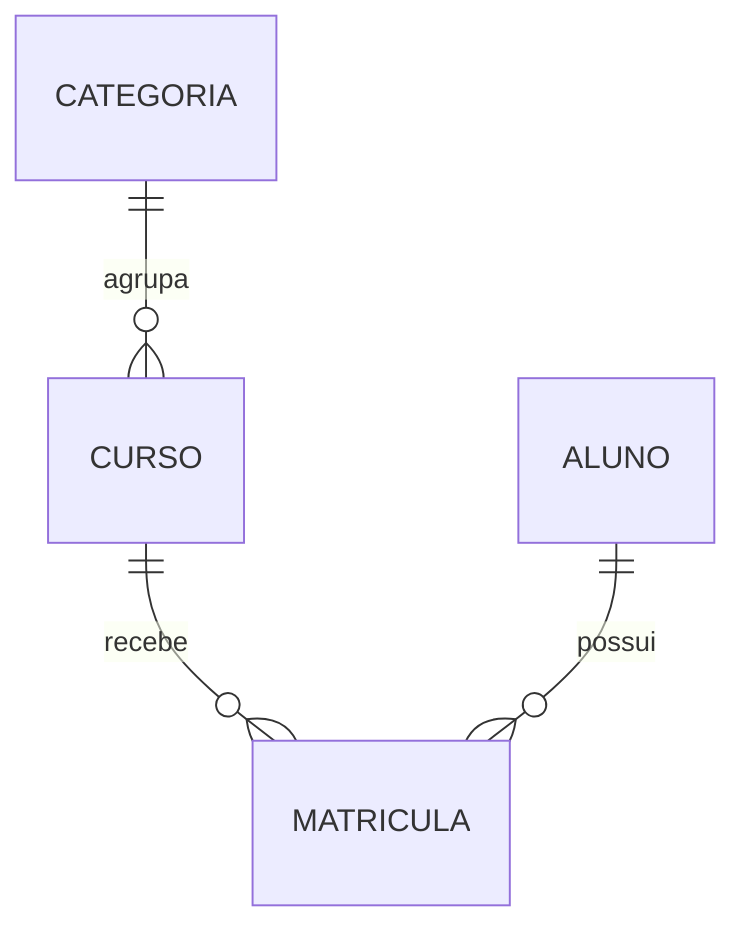

# CursoLab — API de cursos e matrículas

Projeto de Backend Development, PUCPR, desenvolvido para a **Opção 1 — Estendendo os serviços**. A API permite cadastrar categorias, cursos e alunos, além de matricular alunos em cursos.

Repositório: [JoaoVLC/CursoLabBackEnd](https://github.com/JoaoVLC/CursoLabBackEnd).

Esta é a versão para a **apresentação parcial, com peso de 30% da nota**. A exigência técnica dessa etapa é implementar pelo menos metade dos endpoints planejados.

## Integrantes

- João Vitor Lima Cecilio
- Barbara Franco

## Vídeo no YouTube

**Pendente para a entrega final:** inserir aqui o link do vídeo no YouTube. Pode ser não listado. Todos os integrantes precisam participar do vídeo ou entregar seus próprios vídeos, conforme o enunciado.

## Situação da parcial de 29/10/2026

**16 dos 18 endpoints do escopo final estão implementados: 88,9% dos endpoints.** O mínimo, neste escopo, é 9. Isso se refere à quantidade de endpoints; não significa que 88,9% de todos os requisitos ou da nota estejam concluídos.

Uma operação é contada como a combinação de método HTTP e rota. O health check e as páginas de infraestrutura não entram na contagem.

**A autenticação JWT ainda não está implementada.** Os endpoints desta parcial estão abertos, inclusive PUT e DELETE. A aplicação inicia somente em `127.0.0.1` para a demonstração local. A entrega final ainda precisa da autenticação/proteção das ações, do vídeo e da identificação completa da equipe.

| Requisito | Implementação na parcial |
|---|---|
| Quatro novas classes de domínio | Categoria, Curso, Aluno e Matricula |
| Dois tipos de relacionamento | Categoria 1:N Curso; Aluno N:N Curso por Matricula |
| CRUD completo de duas classes | Curso e Aluno |
| Endpoints de associação | Criar, listar e remover matrículas; definir/trocar categoria no POST/PUT de curso |
| Consulta com filtros e ordenação | GET /api/cursos com parâmetros de query |
| Logs e exceções em pelo menos dois serviços | CursoService, AlunoService e também os demais serviços |
| Autenticação para ações destrutivas | **Pendente para a entrega final** |
| GitHub, integrantes e vídeo | Código publicado neste repositório; revisar os integrantes e inserir o vídeo |

## Tecnologias e origem da base

- Kotlin **2.2.21**, Spring Boot **4.0.7** e Java **21**.
- Gradle Wrapper **9.6.1**, Spring Data JPA, H2 e Bean Validation.
- Springdoc/Swagger **3.0.2** e JUnit.
- A organização por entidade, as versões e o Gradle Wrapper foram baseados no `authserver_aula04.zip` fornecido na disciplina do professor Vinícius Godoy Mendonça.
- O modelo de cursos e matrículas é uma aplicação nova construída sobre essa estrutura. O código segue Controller → Service → Repository, com entidades e DTOs separados.
- O material inicial contém exemplos com Spring Boot 4.0.5; este projeto segue o **build.gradle.kts enviado**, que utiliza 4.0.7.

## Executar no Windows

### Executável incluído no ZIP da parcial

O ZIP original da parcial inclui `executavel/cursolab.jar`, compilado a partir deste código. Com Java 21 configurado, extraia toda a pasta do ZIP original e abra **apresentar-windows.bat**. Aguarde o servidor iniciar e acesse o Swagger. Esse caminho não baixa Gradle nem bibliotecas e pode ser usado sem internet depois de instalar o Java.

O JAR pronto não está versionado neste repositório. Ao clonar ou baixar o código pelo GitHub, siga o caminho de desenvolvimento abaixo ou utilize **iniciar-windows.bat**.

O executável contém a mesma parcial do código-fonte. Se você alterar o código, use o caminho de desenvolvimento abaixo para compilar as mudanças; o JAR pronto não é atualizado automaticamente.

### Caminho para desenvolver e executar o código

1. Extraia **toda** a pasta do ZIP. Não execute os arquivos de dentro do ZIP.
2. Tenha um **JDK 21** instalado. JRE sozinho não compila o projeto. Uma opção é o [Temurin 21](https://adoptium.net/temurin/releases/?version=21).
3. Confira no terminal: `java -version` e `javac -version`. Ambos devem indicar a versão 21 para este passo a passo. Se necessário, ajuste `JAVA_HOME` para a pasta do JDK 21 e abra um novo terminal.
4. Abra a pasta do projeto no terminal e execute:

```powershell
.\gradlew.bat bootRun
```

Também é possível abrir `iniciar-windows.bat`. O primeiro início precisa de internet para baixar Gradle e dependências. Não é necessário instalar Gradle, MySQL ou Docker separadamente.

5. Aguarde a mensagem `Started CursoLabApplicationKt` ou `Started CursoLabApplication` nos logs.
6. Abra [Swagger](http://localhost:8080/api/swagger-ui/index.html).
7. Deixe o terminal aberto. Use `Ctrl+C` para parar o servidor.

### Pelo IntelliJ IDEA

Abra a pasta que contém `build.gradle.kts`; importe o projeto Gradle e selecione o JDK 21 no projeto e em Gradle JVM. Espere a sincronização terminar. Execute a função `main` de `src/main/kotlin/br/pucpr/cursolab/CursoLabApplication.kt` ou a tarefa Gradle `bootRun`.

### Linux e macOS

Com JDK 21 instalado:

```bash
chmod +x gradlew
./gradlew bootRun
```

## Endereços

| Recurso | URL |
|---|---|
| Swagger | http://localhost:8080/api/swagger-ui/index.html |
| Especificação OpenAPI | http://localhost:8080/api/v3/api-docs |
| Verificação do servidor | http://localhost:8080/api/health |
| Console H2 | http://localhost:8080/api/h2-console |

No H2 Console, utilize `org.h2.Driver`, JDBC URL `jdbc:h2:file:./data/cursolab`, usuário `sa` e senha `sa` (valores locais padrão). O banco real da aplicação está na pasta `data/`, e permanece após reiniciar. Os testes utilizam outro banco, em memória.

## Dados de demonstração

O `SeedData` insere dados fictícios somente quando o banco está completamente vazio:

- Categorias: Programação e Banco de Dados.
- Cursos: Kotlin para iniciantes (20h), API REST com Spring Boot (40h) e SQL essencial (30h).
- Alunos: Ana Exemplo e Bruno Exemplo, com e-mails `example.com`.
- Uma matrícula de Ana em Kotlin para iniciantes.

Consulte os GETs para descobrir os IDs atuais. Depois de criar, alterar ou excluir registros, não presuma que os IDs continuam iguais aos do primeiro início.

## Modelo



`Categoria` e `Curso` formam um relacionamento um-para-muitos. `Aluno` e `Curso` formam um muitos-para-muitos **com entidade intermediária**, `Matricula`, que registra também `criadaEm`. Por isso a implementação usa dois relacionamentos `@ManyToOne` na matrícula, sem uma anotação `@ManyToMany` direta.

O par `(aluno_id, curso_id)` é único no banco: o mesmo aluno não pode ser matriculado duas vezes no mesmo curso.

## Endpoints

Todos usam o prefixo `/api`.

| Nº | Método | Rota | Função | Situação |
|---|---|---|---|---|
| 1 | POST | /categorias | Cadastrar categoria | Implementado |
| 2 | GET | /categorias | Listar categorias | Implementado |
| 3 | POST | /cursos | Cadastrar curso e associar categoria | Implementado |
| 4 | GET | /cursos | Listar, filtrar e ordenar cursos | Implementado |
| 5 | GET | /cursos/{id} | Consultar curso | Implementado |
| 6 | PUT | /cursos/{id} | Atualizar curso e/ou trocar categoria | Implementado |
| 7 | DELETE | /cursos/{id} | Excluir curso sem matrículas | Implementado |
| 8 | POST | /alunos | Cadastrar aluno | Implementado |
| 9 | GET | /alunos | Listar alunos | Implementado |
| 10 | GET | /alunos/{id} | Consultar aluno | Implementado |
| 11 | PUT | /alunos/{id} | Atualizar aluno | Implementado |
| 12 | DELETE | /alunos/{id} | Excluir aluno sem matrículas | Implementado |
| 13 | POST | /cursos/{cursoId}/matriculas | Matricular aluno | Implementado |
| 14 | GET | /cursos/{cursoId}/matriculas | Consultar matrículas do curso | Implementado |
| 15 | DELETE | /cursos/{cursoId}/matriculas/{alunoId} | Remover associação | Implementado |
| 16 | GET | /alunos/{alunoId}/matriculas | Consultar matrículas do aluno | Implementado |
| 17 | POST | /auth/login | Autenticar e emitir JWT | Planejado para a final |
| 18 | GET | /auth/me | Consultar operador autenticado | Planejado para a final |

Os endpoints planejados **não são rotas fictícias nem stubs**: ainda não existem. A entidade de conta de acesso será separada de `Aluno`; nem todo aluno cadastrado precisa operar a API. A proteção das rotas existentes será acrescentada junto com a autenticação.

## Exemplos de JSON

Criar categoria:

```json
{"nome": "Desenvolvimento Web"}
```

Criar ou substituir os dados de um curso — ajuste `categoriaId` para um ID existente:

```json
{
  "titulo": "Kotlin aplicado",
  "descricao": "Exercícios práticos de Kotlin.",
  "cargaHoraria": 24,
  "categoriaId": 1
}
```

Criar ou atualizar um aluno:

```json
{"nome": "Carla Exemplo", "email": "carla@example.com"}
```

Matricular — use o ID retornado pelo cadastro do aluno:

```json
{"alunoId": 3}
```

O `PUT` recebe o conjunto de campos do cadastro. Não é atualização parcial com `PATCH`.

## Filtros, ordenação e paginação

```http
GET /api/cursos?titulo=kotlin&categoriaId=1&minHoras=20&ordenarPor=cargaHoraria&direcao=DESC&pagina=0&tamanho=10
```

| Parâmetro | Significado |
|---|---|
| titulo | Trecho do título, sem diferenciar maiúsculas de minúsculas |
| categoriaId | Categoria exata |
| minHoras | Carga horária mínima, entre 1 e 1000 |
| ordenarPor | `titulo`, `cargaHoraria` ou `id` |
| direcao | `ASC` ou `DESC` |
| pagina | Página começando em 0 |
| tamanho | De 1 a 100 registros; padrão 50 |

A paginação também existe na listagem de alunos e de matrículas. O retorno é uma lista; não inclui total de páginas. A busca usa parâmetros JPQL e a ordenação aceita apenas os campos definidos no serviço.

## Regras e respostas HTTP

- **200:** consulta ou atualização bem-sucedida.
- **201:** registro criado.
- **204:** exclusão bem-sucedida, sem corpo de resposta.
- **400:** JSON malformado, tipo incorreto ou ordenação inválida.
- **404:** curso, aluno, categoria ou matrícula não encontrados.
- **409:** e-mail/categoria/matrícula duplicados ou tentativa de excluir aluno/curso matriculado.
- **422:** violação de validação, como nome vazio, e-mail inválido ou carga horária zero.

`GlobalExceptionHandler` usa `ProblemDetail`, seguindo a estrutura da base enviada. Os serviços registram eventos e falhas de negócio com SLF4J. Os controllers recebem DTOs de entrada e devolvem DTOs de saída; entidades JPA não são serializadas diretamente.

## Testes

Esta entrega foi compilada em Java 21 e passou nos **8 testes de integração**. O JAR também foi iniciado para verificar Swagger, contagem de operações e persistência após reiniciar. Veja [VALIDACAO.md](VALIDACAO.md).

```powershell
.\gradlew.bat test
```

Relatório: `build/reports/tests/test/index.html`. A suíte de integração exercita os CRUDs, filtros combinados, paginação, os dois lados das matrículas, duplicidade, integridade de exclusão e respostas a entradas inválidas. O banco de teste é isolado do banco da demonstração.

Para compilar também o executável:

```powershell
.\gradlew.bat test bootJar
java -jar .\build\libs\cursolab-0.0.1-SNAPSHOT.jar
```

## Arquivos para estudar

Comece pelo [GUIA_DE_ESTUDO.md](GUIA_DE_ESTUDO.md). Para ensaiar, siga o [ROTEIRO_APRESENTACAO.md](ROTEIRO_APRESENTACAO.md). O arquivo [requisicoes.http](requisicoes.http) contém exemplos adicionais.

## Próxima etapa: entrega final

1. Acrescentar conta de operador, hash de senha, login e token JWT.
2. Proteger criação/alteração/exclusão e os dados de alunos/matrículas; testar pedidos sem token, com token inválido e com token válido.
3. Revisar a implementação de segurança com a Aula 07 e a configuração com a Aula 08.
4. Revisar o código com todos os integrantes e preencher seus nomes neste README.
5. Atualizar este repositório conforme o projeto evoluir e gravar o vídeo com a participação de todos.
6. Inserir o link do YouTube acima e fazer a entrega individual, como pede o enunciado.

## Obter o código pelo GitHub

Na página deste repositório, utilize **Code → Download ZIP** ou clone com Git:

```bash
git clone https://github.com/JoaoVLC/CursoLabBackEnd.git
cd CursoLabBackEnd
```

Abra a pasta que contém `build.gradle.kts` no IntelliJ e siga a seção de execução. O `.gitignore` exclui `build/`, `.gradle/`, `executavel/`, dados locais e configurações da IDE. O repositório inclui `src`, `gradle/wrapper`, os dois arquivos `gradlew`, os arquivos Gradle e a documentação. Os registros criados no Swagger ficam no banco local de cada computador.

## Dificuldades comuns

| Mensagem ou situação | O que fazer |
|---|---|
| `java` ou `javac` não reconhecido | Instalar/configurar JDK 21 e abrir um novo terminal |
| `Cannot find a Java installation ... 21` | Selecionar JDK 21 no IntelliJ/Gradle JVM ou ajustar JAVA_HOME |
| Download de dependências falhou | Conferir internet e tentar novamente; a primeira execução baixa bibliotecas |
| Porta 8080 ocupada | Parar a outra execução ou definir `$env:PORT="8081"` no PowerShell antes de iniciar |
| `Database may be already in use` | Encerrar a outra instância do CursoLab antes de iniciar |
| `409` ao repetir o exemplo | Consultar o registro já criado ou usar outro e-mail; duplicidade é bloqueada |
| Swagger retorna erro | Confirmar que o servidor iniciou e usar a URL completa com `/api` |

Para refazer a demonstração do zero, pare a aplicação e **renomeie** a pasta `data` para guardar uma cópia. No próximo início um novo banco será criado. Esse procedimento é opcional e não ocorre automaticamente.

## Referências

- Materiais da disciplina enviados: Conceitos Iniciais, JPA/Relacionamentos e authserver da Aula 04.
- [Spring Boot](https://docs.spring.io/spring-boot/)
- [Spring Data JPA](https://docs.spring.io/spring-data/jpa/reference/)
- [Springdoc OpenAPI](https://springdoc.org/)
