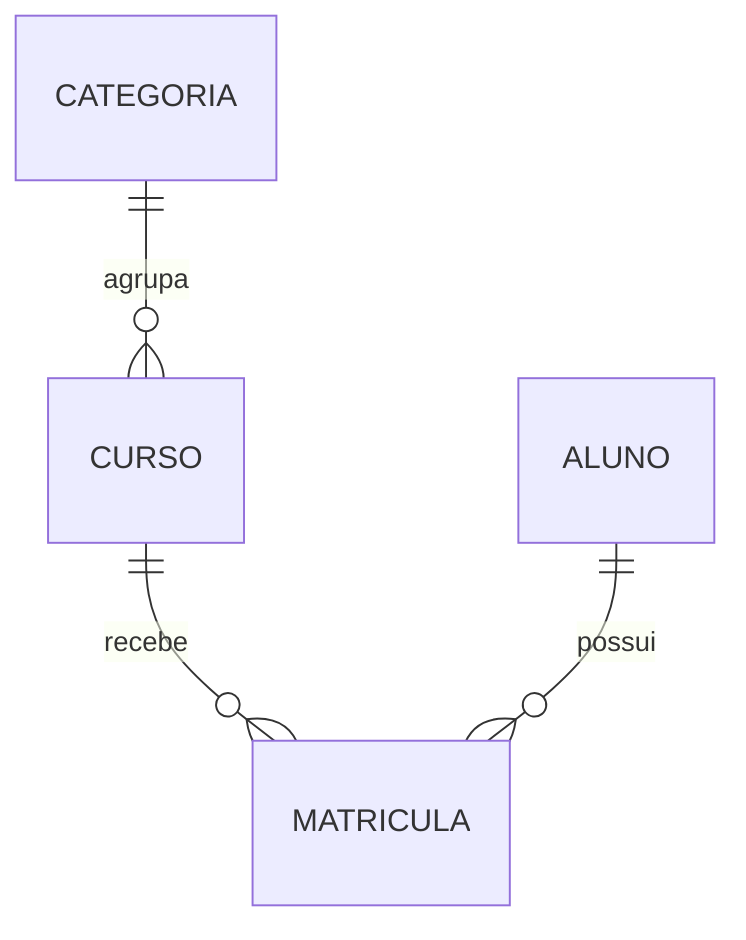

# CursoLab — API de cursos e matrículas

Projeto de Backend Development, PUCPR, desenvolvido para a **Opção 1 — Estendendo os serviços**. A API permite cadastrar categorias, cursos e alunos, além de matricular alunos em cursos.

## Integrantes

- João Vitor Lima Cecilio
- Bárbara Franco

## Vídeo de apresentação

https://youtu.be/cHTZTLh5IL8

## Requisitos

| Requisito | Implementação |
|---|---|
| Quatro novas classes de domínio | Categoria, Curso, Aluno e Matricula |
| Dois tipos de relacionamento | Categoria 1:N Curso; Aluno N:N Curso por Matricula |
| CRUD completo de duas classes | Curso e Aluno |
| Endpoints de associação | Criar, listar e remover matrículas; definir/trocar categoria no POST/PUT de curso |
| Consulta com filtros e ordenação | GET /api/cursos com parâmetros de query |
| Logs e exceções em pelo menos dois serviços | CursoService, AlunoService e também os demais serviços |
| Autenticação para ações destrutivas | Login com senha BCrypt e JWT obrigatório para criação, alteração e exclusão |

## Tecnologias e origem da base

- Kotlin **2.2.21**, Spring Boot **4.0.7** e Java **21**.
- Gradle Wrapper **9.6.1**, Spring Data JPA, H2 e Bean Validation.
- Spring Security com JWT, Springdoc/Swagger **3.0.2** e JUnit.
- A organização por entidade, as versões e o Gradle Wrapper foram baseados no `authserver_aula04.zip` fornecido na disciplina do professor Vinícius Godoy Mendonça.
- O modelo de cursos e matrículas é uma aplicação nova construída sobre essa estrutura. O código segue Controller → Service → Repository, com entidades e DTOs separados.
- O material inicial contém exemplos com Spring Boot 4.0.5; este projeto segue o **build.gradle.kts enviado**, que utiliza 4.0.7.

## Executar no Windows

1. Clone o repositório ou extraia o ZIP. Abra no IntelliJ a pasta que contém `build.gradle.kts`.
2. Configure o **JDK 21** como JDK do projeto e do Gradle. Confira `java -version` e `javac -version` no terminal. Caso necessário, instale o [Temurin 21](https://adoptium.net/temurin/releases/?version=21).
3. No PowerShell da pasta do projeto, cadastre a conta local ao iniciar a aplicação. Escolha uma senha para a demonstração com pelo menos 8 caracteres e até 72 bytes em UTF-8.

```powershell
$env:CURSOLAB_OPERADOR_USUARIO = "operador"
$env:CURSOLAB_OPERADOR_SENHA = [System.Net.NetworkCredential]::new("", (Read-Host "Senha local do operador" -AsSecureString)).Password
.\gradlew.bat bootRun
```

4. Aguarde a mensagem `Started CursoLabApplicationKt` ou `Started CursoLabApplication`. Ao criar a conta, o servidor também registra `Operador cadastrado`.
5. Abra o [Swagger](http://localhost:8080/api/swagger-ui/index.html). Mantenha o terminal aberto e use `Ctrl+C` para parar o servidor.

O primeiro build baixa as dependências pelo Gradle Wrapper. O banco H2 é incluído na aplicação e guarda os registros em `data/`.

As variáveis de ambiente valem para o terminal onde foram definidas. Depois de cadastrar a conta, você pode fechar o terminal e executar de novo com `.\gradlew.bat bootRun` ou `iniciar-windows.bat`. A conta permanece no banco. Se quiser mudar a senha, defina a nova senha para o mesmo usuário e inicie novamente.

### Gerar o executável para a demonstração

```powershell
.\gradlew.bat bootJar
java -jar .\build\libs\cursolab-1.0.0.jar
```

Após gerar o JAR, `apresentar-windows.bat` também pode abri-lo. Gere um novo JAR após mudanças de código. Para usar o mesmo banco, inicie a aplicação na pasta que contém `build.gradle.kts`. Mantenha uma instância por vez.

### Linux e macOS

```bash
read -rs CURSOLAB_OPERADOR_SENHA
export CURSOLAB_OPERADOR_SENHA
./gradlew bootRun
```

Digite a senha ao executar `read`. O usuário padrão é `operador`.

## Usar a autenticação no Swagger

1. Em **0. Autenticação**, abra `POST /auth/login` e clique em **Try it out**.
2. Envie o JSON abaixo usando a senha escolhida no PowerShell.

```json
{"usuario": "operador", "senha": "SUBSTITUA_PELA_SUA_SENHA_LOCAL"}
```

3. Copie o valor de `accessToken` da resposta e cole no botão **Authorize** do Swagger. Ele acrescenta o prefixo `Bearer` ao enviar o cabeçalho `Authorization`.
4. Execute `GET /auth/me` para conferir o usuário autenticado. As operações com cadeado também podem ser usadas.

`OperadorInicial` cadastra a conta ou atualiza sua senha conforme a configuração de entrada. A entidade `Operador` tem tabela própria e guarda somente o hash BCrypt da senha. `AuthService` verifica as credenciais e emite um token que vale 30 minutos. A chave de assinatura é gerada em memória a cada início da aplicação. Faça login novamente depois de reiniciar ou quando o token expirar.

O catálogo de cursos e categorias permanece público. O Spring Security exige autenticação para qualquer operação de escrita e para as consultas de alunos e matrículas. Em um banco novo, defina a senha do operador para usar essas rotas.

## Endereços

| Recurso | URL |
|---|---|
| Swagger | http://localhost:8080/api/swagger-ui/index.html |
| Especificação OpenAPI | http://localhost:8080/api/v3/api-docs |
| Verificação do servidor | http://localhost:8080/api/health |

O servidor escuta no endereço local `127.0.0.1`. A URL padrão do banco é `jdbc:h2:file:./data/cursolab`. A versão final usa a API para acesso aos dados e remove o console web do H2.

## Dados de demonstração

O `SeedData` insere os seguintes dados fictícios quando ainda não há registros de categorias, cursos, alunos ou matrículas.

- Categorias: Programação e Banco de Dados.
- Cursos: Kotlin para iniciantes (20h), API REST com Spring Boot (40h) e SQL essencial (30h).
- Alunos: Ana Exemplo e Bruno Exemplo, com e-mails `example.com`.
- Uma matrícula de Ana em Kotlin para iniciantes.

Consulte os GETs para descobrir os IDs atuais. Depois de criar, alterar ou excluir registros, não presuma que os IDs continuam iguais aos do primeiro início.

## Modelo



`Categoria` e `Curso` formam um relacionamento um para muitos. `Aluno` e `Curso` formam um relacionamento muitos para muitos por meio de `Matricula`. A matrícula guarda a data em `criadaEm` e usa dois vínculos `@ManyToOne`, um para cada entidade.

O par `(aluno_id, curso_id)` é único no banco: o mesmo aluno não pode ser matriculado duas vezes no mesmo curso.

## Endpoints

Os 18 endpoints de negócio usam o prefixo `/api`.

| Nº | Método | Rota | Função | Acesso |
|---|---|---|---|---|
| 1 | POST | /categorias | Cadastrar categoria | JWT |
| 2 | GET | /categorias | Listar categorias | Público |
| 3 | POST | /cursos | Cadastrar curso e associar categoria | JWT |
| 4 | GET | /cursos | Listar, filtrar e ordenar cursos | Público |
| 5 | GET | /cursos/{id} | Consultar curso | Público |
| 6 | PUT | /cursos/{id} | Atualizar curso e/ou trocar categoria | JWT |
| 7 | DELETE | /cursos/{id} | Excluir curso sem matrículas | JWT |
| 8 | POST | /alunos | Cadastrar aluno | JWT |
| 9 | GET | /alunos | Listar alunos | JWT |
| 10 | GET | /alunos/{id} | Consultar aluno | JWT |
| 11 | PUT | /alunos/{id} | Atualizar aluno | JWT |
| 12 | DELETE | /alunos/{id} | Excluir aluno sem matrículas | JWT |
| 13 | POST | /cursos/{cursoId}/matriculas | Matricular aluno | JWT |
| 14 | GET | /cursos/{cursoId}/matriculas | Consultar matrículas do curso | JWT |
| 15 | DELETE | /cursos/{cursoId}/matriculas/{alunoId} | Remover associação | JWT |
| 16 | GET | /alunos/{alunoId}/matriculas | Consultar matrículas do aluno | JWT |
| 17 | POST | /auth/login | Verificar credenciais e emitir JWT | Usuário e senha |
| 18 | GET | /auth/me | Consultar operador autenticado | JWT |

## Exemplos de JSON

Criar categoria:

```json
{"nome": "Desenvolvimento Web"}
```

Criar ou substituir os dados de um curso — ajuste `categoriaId` para um ID existente:

```json
{
  "titulo": "Kotlin aplicado",
  "descricao": "Exercícios práticos de Kotlin.",
  "cargaHoraria": 24,
  "categoriaId": 1
}
```

Criar ou atualizar um aluno:

```json
{"nome": "Carla Exemplo", "email": "carla@example.com"}
```

Matricular — use o ID retornado pelo cadastro do aluno:

```json
{"alunoId": 3}
```

O `PUT` recebe o conjunto de campos do cadastro. Não é atualização parcial com `PATCH`.

## Filtros, ordenação e paginação

```http
GET /api/cursos?titulo=kotlin&categoriaId=1&minHoras=20&ordenarPor=cargaHoraria&direcao=DESC&pagina=0&tamanho=10
```

| Parâmetro | Significado |
|---|---|
| titulo | Trecho do título, sem diferenciar maiúsculas de minúsculas |
| categoriaId | Categoria exata |
| minHoras | Carga horária mínima, entre 1 e 1000 |
| ordenarPor | `titulo`, `cargaHoraria` ou `id` |
| direcao | `ASC` ou `DESC` |
| pagina | Página começando em 0 |
| tamanho | De 1 a 100 registros; padrão 50 |

A paginação também existe na listagem de alunos e de matrículas. O retorno é uma lista; não inclui total de páginas. A busca usa parâmetros JPQL e a ordenação aceita apenas os campos definidos no serviço.

## Regras e respostas HTTP

- **200:** consulta ou atualização bem-sucedida.
- **201:** registro criado.
- **204:** exclusão bem-sucedida, sem corpo de resposta.
- **400:** JSON malformado, tipo incorreto ou ordenação inválida.
- **401:** credenciais de login incorretas ou token ausente, inválido ou expirado.
- **403:** token válido sem a permissão de operador.
- **404:** curso, aluno, categoria ou matrícula não encontrados.
- **409:** e-mail/categoria/matrícula duplicados ou tentativa de excluir aluno/curso matriculado.
- **422:** violação de validação, como nome vazio, e-mail inválido ou carga horária zero.

`GlobalExceptionHandler` usa `ProblemDetail`, seguindo a estrutura da base enviada. Os serviços registram eventos e falhas de negócio com SLF4J. Os controllers recebem DTOs de entrada e devolvem DTOs de saída; entidades JPA não são serializadas diretamente.

## Testes

Execute a suíte com o JDK 21.

```powershell
.\gradlew.bat test
```

O relatório fica em `build/reports/tests/test/index.html`. Os testes usam H2 em memória e incluem CRUDs, filtros, matrículas, validações, login e proteção de rotas. Veja os resultados em [VALIDACAO.md](VALIDACAO.md).

## Arquivos para estudar

Comece pelo [GUIA_DE_ESTUDO.md](GUIA_DE_ESTUDO.md). Para ensaiar, siga o [ROTEIRO_APRESENTACAO.md](ROTEIRO_APRESENTACAO.md). O arquivo [requisicoes.http](requisicoes.http) contém exemplos adicionais.

## Obter o código pelo GitHub

Na página deste repositório, utilize **Code → Download ZIP** ou clone com Git:

```bash
git clone https://github.com/JoaoVLC/CursoLabBackEnd.git
cd CursoLabBackEnd
```

Abra a pasta que contém `build.gradle.kts` no IntelliJ e siga a seção de execução. O `.gitignore` exclui `build/`, `.gradle/`, `executavel/`, dados locais e configurações da IDE. O repositório inclui `src`, `gradle/wrapper`, os dois arquivos `gradlew`, os arquivos Gradle e a documentação. Os registros criados no Swagger ficam no banco local de cada computador.

## Dificuldades comuns

| Mensagem ou situação | O que fazer |
|---|---|
| `java` ou `javac` não reconhecido | Instalar/configurar JDK 21 e abrir um novo terminal |
| `Cannot find a Java installation ... 21` | Selecionar JDK 21 no IntelliJ/Gradle JVM ou ajustar JAVA_HOME |
| Download de dependências falhou | Conferir internet e tentar novamente; a primeira execução baixa bibliotecas |
| Porta 8080 ocupada | Parar a outra execução ou definir `$env:PORT="8081"` no PowerShell antes de iniciar |
| `Database may be already in use` | Encerrar a outra instância do CursoLab antes de iniciar |
| `409` ao repetir o exemplo | Consultar o registro já criado ou usar outro e-mail; duplicidade é bloqueada |
| `401` no login em banco novo | Definir `CURSOLAB_OPERADOR_SENHA` no terminal e iniciar a aplicação para criar a conta |
| `401` em operação com cadeado | Fazer login e colar o novo `accessToken` em **Authorize** |
| Swagger retorna erro | Confirmar que o servidor iniciou e usar a URL completa com `/api` |

Para refazer a demonstração do zero, pare a aplicação e **renomeie** a pasta `data` para guardar uma cópia. No próximo início um novo banco será criado. Esse procedimento é opcional e não ocorre automaticamente.

## Referências

- Materiais da disciplina enviados: Conceitos Iniciais, JPA/Relacionamentos e authserver da Aula 04.
- [Spring Boot](https://docs.spring.io/spring-boot/)
- [Spring Data JPA](https://docs.spring.io/spring-data/jpa/reference/)
- [Spring Security com JWT](https://docs.spring.io/spring-security/reference/7.0/servlet/oauth2/resource-server/jwt.html)
- [Springdoc OpenAPI](https://springdoc.org/)
